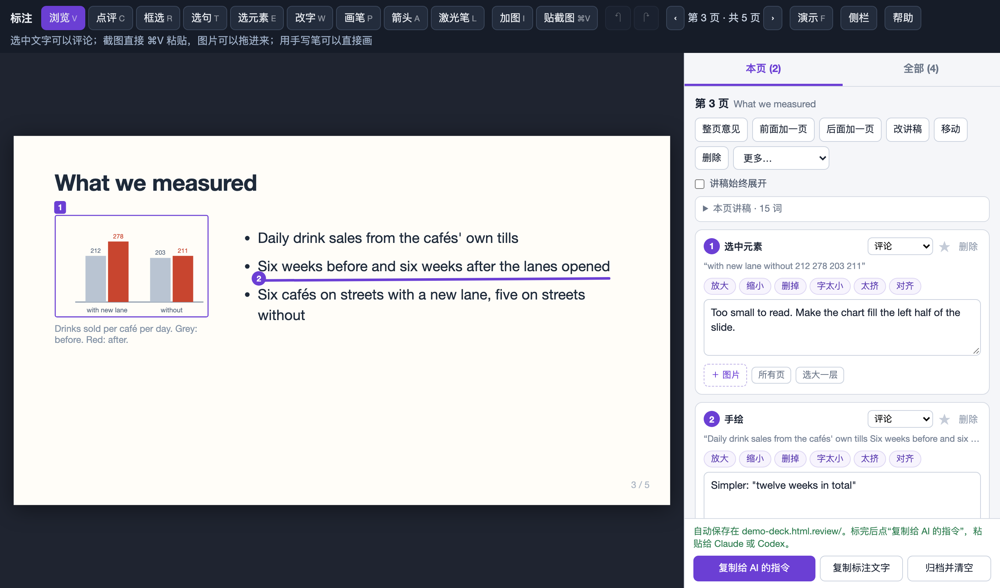
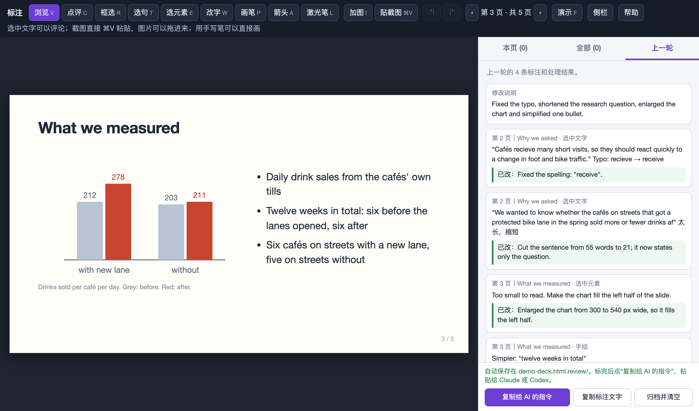

<p align="center">
  
</p>

<h1 align="center">Redpen</h1>

<p align="center">
  <b>Mark it up like a teacher. Your AI agent makes the edits.</b><br>
  Review slides, papers, posters and figures in the browser or by hand on an iPad,<br>
  then hand the notes to Claude Code, Codex or any other coding agent.
</p>

<p align="center">
  <a href="README.zh-CN.md">中文说明</a> ·
  <a href="docs/tutorial.md">Tutorial</a> ·
  <a href="docs/tutorial.zh-CN.md">中文教程</a> ·
  <a href="AGENTS.md">Instructions for agents</a>
</p>

<p align="center">
  
  
  
</p>



## Why

Telling an agent what to change in a document is slow when you have to describe *where*: "the second bullet on
slide 3, no, the one under the chart". With Redpen you point at the thing instead. Click a sentence, circle a
figure, paste a screenshot, scribble with a pencil. Each note is saved with what the agent needs to find it in the
source: the exact text, the element, the page coordinates, and for LaTeX papers the `.tex` file and line.

When you are done, you paste one instruction to your agent. It edits the source, rebuilds, and writes a one-line
reply under every note, which shows up back in the review page.

## Quick start

Redpen is three files and needs only Python 3. There is nothing to install.

```bash
git clone https://github.com/Sijie-Yang/redpen.git
```

```bash
python3 redpen/review.py redpen/examples/demo-deck.html
```

Your browser opens the demo deck. It has a typo, a sentence that is far too long and a chart that is too small.
Mark them up, click **复制给 AI 的指令** (copy the instruction for the AI) at the bottom right, and paste it to
your agent. The [tutorial](docs/tutorial.md) walks through this in ten minutes.

To review your own file, give its path:

```bash
python3 redpen/review.py path/to/talk.html
```

PDFs need [poppler](https://poppler.freedesktop.org) (`brew install poppler` on macOS, `apt install poppler-utils`
on Debian and Ubuntu).

> **Language.** The review page is in Chinese for now. Every tool has a one-letter shortcut, and the tutorial gives
> each label with its English meaning. The notes you write can be in any language. A translation of the interface
> would be a welcome contribution.

## How a round works

1. **You mark up.** Notes are saved as you go, in a folder next to the file (`talk.html.review/`).
2. **You hand over.** One click copies an instruction that contains every path the agent needs. Paste it into any
   agent, in any project.
3. **The agent edits.** It reads the notes, changes the source file, rebuilds, replies to each note and archives
   the round. The open review page clears itself, shows the replies and offers to reload the new version.



## What you can review

| File | What you can do |
|---|---|
| HTML slide decks (reveal.js, remark, hand-written, any framework) | Everything: comment on a sentence, retype text in place, comment on elements, add, delete and move slides, rewrite speaker notes |
| Other HTML pages (posters, reports) | Comment on sentences and elements, retype text, pin, box, add images, draw |
| PDF (papers, exported slides) | Comment on sentences, pin, box, add images, draw. With SyncTeX, each note carries the `.tex` file and line |
| Images (PNG, JPG, SVG, WebP) or a folder of images | Pin, box, add images, draw |
| PowerPoint, Keynote | Export to PDF first |

## Marking up

| You want to | Do this |
|---|---|
| Comment on a sentence | Press `T` and click the sentence. Or select any text and choose from the small bar: comment, rewrite, shorten, delete |
| Retype text in place (HTML) | Press `W`, click the text, edit it, press Enter |
| Comment on a figure or a block | `E` selects a whole element, `C` drops a pin anywhere, `R` drags a box |
| Show what you mean with a picture | Take a screenshot and paste it (`⌘V` / `Ctrl+V`). It lands on the page; drag to move or resize. Drop it on an existing image to say "replace this one" |
| Attach a picture to one note | Click into that note's text box, then paste, or drop the file on the card |
| Draw | `P` for freehand, `A` for an arrow from one place to another |
| Change the deck itself | Sidebar buttons: add a slide before or after, move, delete, split, merge, move to backup, "do not touch this slide" |
| Rewrite speaker notes | Sidebar: **改讲稿** |
| Present | `F` for full screen with only the slides, `L` for a laser pointer |
| Everything else | ★ marks a note as important, **所有页** applies it to every page, `⌘Z` / `Ctrl+Z` undoes, `Esc` returns to browsing, `←` `→` turn pages |

## iPad and Apple Pencil

**Live, on the same Wi-Fi or Tailscale network:**

```bash
python3 redpen/review.py path/to/paper.pdf --lan
```

The terminal prints a link that carries a token. Open it in Safari on the iPad. Write with the Pencil straight on
the page, scroll with your finger. Notes are saved on the computer.

**Offline, with any app:** annotate the PDF by hand in GoodNotes, Notability, Files or anything else, send the
annotated copy back, and tell your agent "I annotated it on my iPad: the original is A, the annotated copy is B".
It runs

```bash
python3 redpen/review.py import original.pdf annotated.pdf
```

which compares the two page by page and stores every handwritten mark as a note with a crop of the handwriting, its
position and the printed text underneath. The agent reads your handwriting from the crops. This step needs
`pip install pillow numpy`.

## Generated files

If the file you review is built from something else, say so once. Redpen remembers it and tells the agent what to
edit and how to rebuild:

```bash
python3 redpen/review.py paper.pdf --source paper.tex --build "latexmk -pdf -synctex=1 paper.tex"
```

Compile LaTeX with `-synctex=1` and every note on the PDF will point at the right line of the right `.tex` file.

## Command line

```
python3 review.py FILE                      open the review page (HTML, PDF, image, or a folder of images)
    --source F --build "CMD"                the file to edit and the command that rebuilds FILE; remembered
    --lan                                   also reachable from other devices on the network, with a token
    --port N  --no-open                     choose the port; do not open a browser
    --slides CSS  --notes CSS  --title CSS  selectors, when a deck is not detected correctly
    --page                                  treat an HTML file as one scrolling page, not slides
    --root DIR                              folder to serve, when the HTML loads files from a parent folder

python3 review.py show FILE                 print the current notes as text
python3 review.py prompt FILE               print the instruction to paste to an agent
python3 review.py import FILE MARKED_COPY   read handwriting from a copy annotated elsewhere
python3 review.py archive FILE --summary T  close the round (agents run this when they are done)
```

## For agents

[AGENTS.md](AGENTS.md) is the whole contract: where the notes are, the data format of every note type, how to
locate a note in the source, and how to close a round. The instruction that the review page copies already points
the agent to it, so no setup is needed. `CLAUDE.md` just refers to the same file.

If you want your agent to understand "apply my review notes" without pasting anything, add one line to your global
agent instructions, for example in `~/.claude/CLAUDE.md`:

```
When I ask you to apply my review notes, follow /full/path/to/redpen/AGENTS.md.
```

## Where things are stored

```
talk.html
talk.html.review/
    annotations.md      the notes as text; the agent reads this first
    annotations.json    the same notes with coordinates, target elements and image paths
    images/             screenshots and pictures you attached
    archive/            earlier rounds, with the agent's replies
    history/            automatic copies of earlier versions, for recovery
```

The review folder contains a `.gitignore` that ignores everything in it, so your notes never end up in a commit.

## Privacy and security

- Everything stays on your computer. Redpen makes no network requests and has no telemetry.
- By default the server listens on `127.0.0.1` only and accepts writes only from its own page.
- With `--lan`, other devices need the token in the printed link; a new token is made on every start. Stop the
  server with Ctrl+C when you are done.
- The server can read only the folder of the file under review and can write only into the `.review` folder.

## Repository

| File | Purpose |
|---|---|
| `review.py` | Local server and command line. Standard library only (Pillow and numpy only for `import`) |
| `app.html`, `app.js` | The review page |
| `AGENTS.md`, `CLAUDE.md` | Instructions for the agent that applies the notes |
| `examples/demo-deck.html` | A small deck with deliberate flaws, for trying things out |
| `docs/` | Tutorial |

## License

[MIT](LICENSE) © Sijie Yang
