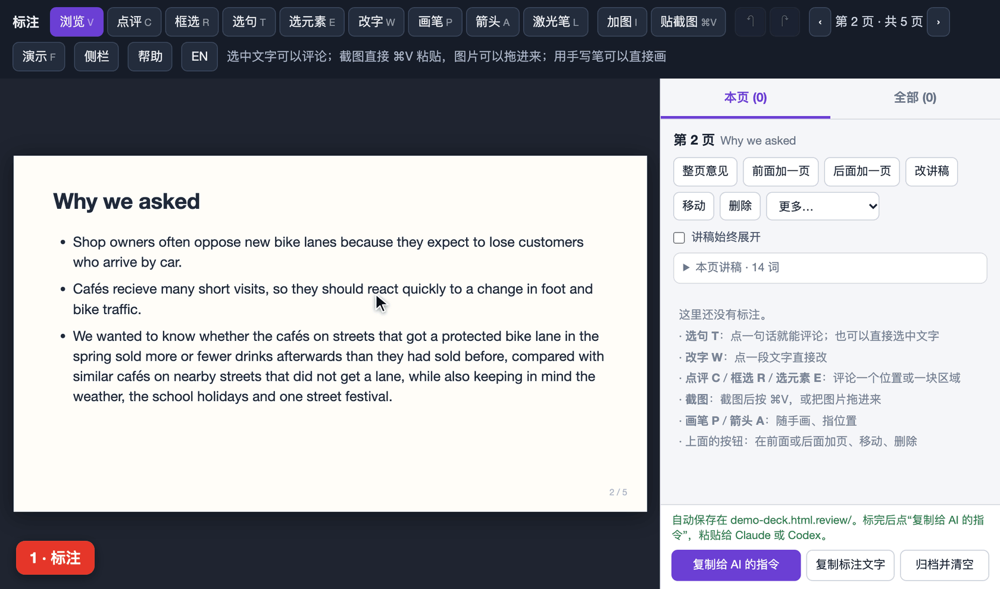
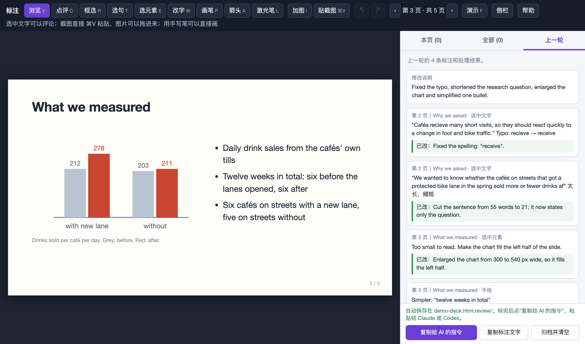
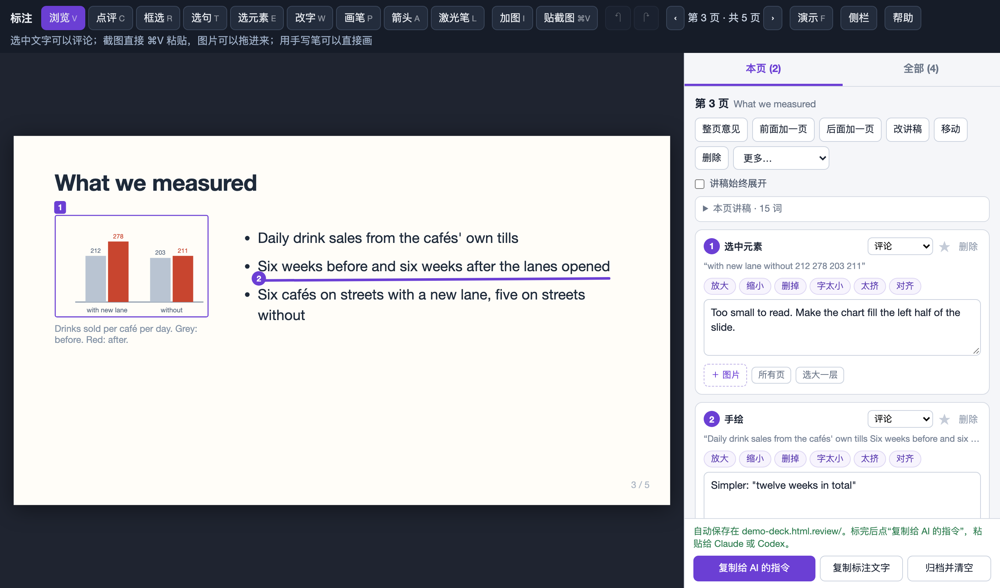

<p align="center">
  
</p>

<h1 align="center">Redpen 红笔</h1>

<p align="center">
  <b>像老师一样拿红笔批改，剩下的交给 AI。</b><br>
  在浏览器里（或在 iPad 上手写）给幻灯片、论文、海报、图片做批注，
  然后让 Claude Code、Codex 或其他 AI 编程助手按批注修改。
</p>

<p align="center">
  <a href="README.md">English</a> ·
  <a href="docs/tutorial.zh-CN.md">教程</a> ·
  <a href="AGENTS.md">给 AI 的说明</a>
</p>



## 为什么做这个

让 AI 改文档，最费劲的是说清楚“改哪里”：“第 3 页第二个要点，不对，是图下面那个”。Redpen 让你直接指：点一句话、圈一张图、
贴一张截图、拿笔随手画。每条批注都带着 AI 定位所需的信息：原文、对应的元素、页面坐标；LaTeX 论文还会给出 `.tex` 文件和行号。

标完之后，把一条指令粘贴给 AI。它去改源文件、重新生成，并在每条批注下面写一句处理结果，这些结果会显示回审阅页面。

## 开始

Redpen 只有三个文件，只需要 Python 3，不用安装。

```bash
git clone https://github.com/Sijie-Yang/redpen.git
```

```bash
python3 redpen/review.py redpen/examples/demo-deck.html
```

浏览器会打开示例幻灯片。里面故意留了一个错别字、一句太长的话、一张太小的图。把它们标出来，点右下角
**“复制给 AI 的指令”**，粘贴给你的 AI。[教程](docs/tutorial.zh-CN.md)会带你走一遍，大约十分钟。

审阅自己的文件，给出路径即可：

```bash
python3 redpen/review.py 文件路径
```

打开 PDF 需要 [poppler](https://poppler.freedesktop.org)（macOS：`brew install poppler`；Debian / Ubuntu：`apt install poppler-utils`）。

> **语言。** 审阅页面有中文和英文两种界面，默认跟随浏览器的语言。工具栏最右边的 **EN** / **中文** 按钮可以切换，选择会被记住。
> 复制给 AI 的指令和标注清单跟着界面的语言走。你写的意见用什么语言都可以。

## 一轮是怎么走的

1. **你批注。** 标注边写边存，放在文件旁边的文件夹里（`talk.html.review/`）。
2. **你交给 AI。** 点一下，复制一条带有全部路径的指令，粘贴到任何 AI、任何项目、任何对话里都能用。
3. **AI 修改。** 它读批注、改源文件、重新生成、逐条回复，然后把这一轮归档。开着的审阅页面会自动清空，
   在“上一轮”里显示每条的处理结果，并提示刷新到新版本。



## 支持的文件

| 文件 | 能做什么 |
|---|---|
| HTML 幻灯片（reveal.js、remark、手写的，任何框架） | 全部功能：选句评论、直接改字、评论元素、加页删页挪页、改讲稿 |
| HTML 海报、报告等单页网页 | 选句、改字、点评、框选、加图、画笔 |
| PDF（论文、导出的幻灯片） | 选句、点评、框选、加图、画笔；编译时带 SyncTeX 的论文会直接给出对应的 `.tex` 文件和行号 |
| 图片（PNG、JPG、SVG、WebP）或一个图片文件夹 | 点评、框选、加图、画笔 |
| PPT、Keynote | 先导出成 PDF |

## 标注



| 想做的事 | 操作 |
|---|---|
| 评论一句话 | 按 `T` 后点那句话；或直接选中文字，在弹出的小条里点“评论 / 改写 / 缩短 / 删掉” |
| 直接改字（HTML） | 按 `W` 后点一段文字，就地修改，回车完成 |
| 评论一张图、一块内容 | `E` 点它选中整个元素；`C` 在任意位置放一个点；`R` 拖一个框 |
| 用图说明想要什么 | 截图后按 `⌘V`（或 `Ctrl+V`），图会出现在这一页上，拖动调整位置和大小。也可以把图片文件拖进来，或点“加图”。拖到已有的图上表示替换它 |
| 给某条意见配图 | 先点进那条意见的输入框再粘贴，或把图片拖到那张卡片上 |
| 画、箭头 | `P` 随手画，`A` 从一处拖到另一处 |
| 加页、删页、挪页 | 右侧“前面加一页 / 后面加一页 / 移动 / 删除”，“更多”里有拆页、合并、移到备用页、这页不要动 |
| 改讲稿 | 右侧“改讲稿”；勾选“讲稿始终展开”可以一直看着讲稿 |
| 全屏演示 | 点“演示”或按 `F`：全屏，只留幻灯片。`←` `→` 或空格翻页，`Esc` 或 `F` 退出 |
| 激光笔 | 按 `L`，红点跟着鼠标走；按住拖动可以画圈，几秒后自动消失。不会记成标注 |
| 缩放（海报、报告这类整页的 HTML） | 打开时自动缩到整页宽度；顶部 `−` `适应` `＋` 调整 |
| 其他 | ★ 标为重要；“所有页”表示每页都照这条改；`⌘Z` 撤销；`Esc` 回到浏览；`←` `→` 翻页 |

## iPad 和 Apple Pencil

**在线（和电脑在同一个 Wi-Fi 或 Tailscale）**

```bash
python3 redpen/review.py 文件路径 --lan
```

终端会打印一个带口令的链接，在 iPad 的 Safari 里打开。用 Apple Pencil 不用选工具，直接在页面上写；手指用来滚动。
标注直接存到电脑上。

**离线**

1. 把 PDF（或图片）传到 iPad，用任何 App 手写批注（文件 App 自带的标记、GoodNotes、Notability、PDF Expert 都行）。
2. 把批注过的文件传回电脑，原件不要覆盖。
3. 对 AI 说“我在 iPad 上批注了，原件是 A，批注件是 B，按批注改”。它会运行：

```bash
python3 redpen/review.py import 原件.pdf 批注件.pdf
```

工具逐页对比两份文件，把每处笔迹截出来，连同位置、下面的印刷文字（论文还有 `.tex` 行号）交给 AI。AI 看截图读你的字。

离线批注的注意点：

- 字写在页面上，不要写在弹出式的便签里（便签的内容不显示在页面上，对比不出来）。
- HTML 幻灯片先导出成 PDF 再批注，页码就是幻灯片序号。
- 这一步需要 Pillow 和 numpy：`pip install pillow numpy`。

## 由别的文件生成的文件

如果被审阅的文件是生成出来的，第一次打开时告诉 Redpen 源文件和生成命令，以后它会记住，并告诉 AI 该改哪个文件、怎么重新生成：

```bash
python3 redpen/review.py paper.pdf --source paper.tex --build "latexmk -pdf -synctex=1 paper.tex"
```

LaTeX 编译时加 `-synctex=1`，PDF 上的每条批注就会直接指向对应 `.tex` 文件的那一行。

## 命令行

```
python3 review.py FILE                      打开审阅页面（HTML、PDF、图片，或一个图片文件夹）
    --source F --build "CMD"                要改的源文件、重新生成 FILE 的命令；会记住
    --lan                                   局域网里的其他设备也能打开，需要口令
    --port N  --no-open                     指定端口；不自动打开浏览器
    --slides CSS  --notes CSS  --title CSS  幻灯片识别不对时，手动给出选择器
    --page                                  把 HTML 当作一个滚动的整页，不按幻灯片处理
    --root DIR                              HTML 引用了上级文件夹里的文件时，指定要提供的根目录
    --lang en|zh                            页面初始的语言，以及终端里提示信息的语言

python3 review.py show FILE                 打印当前的标注（文字版）
python3 review.py prompt FILE               打印要粘贴给 AI 的指令
python3 review.py import FILE MARKED_COPY   从别处批注过的副本里读出手写内容
python3 review.py archive FILE --summary T  结束这一轮（AI 改完后运行）
```

## 给 AI 的说明

[AGENTS.md](AGENTS.md) 是完整的约定：标注在哪、每种标注的数据格式、怎么在源文件里定位、怎么归档。
审阅页面复制出来的指令已经指向它，所以不需要任何配置。`CLAUDE.md` 只是指向同一个文件。

如果想让 AI 一听“按标注改”就明白，不用每次粘贴，可以在全局说明里加一行，比如 `~/.claude/CLAUDE.md`：

```
我说“按标注改”时，按 /完整路径/redpen/AGENTS.md 执行。
```

## 标注存在哪

```
talk.html
talk.html.review/
    annotations.md      文字版的标注，AI 先读这个
    annotations.json    同样的标注，带坐标、目标元素和图片路径
    images/             你贴的截图和图片
    archive/            以前各轮，带 AI 的回复
    history/            自动保存的历史版本，用于找回
```

这个文件夹自带一个忽略全部内容的 `.gitignore`，所以你的批注不会进 git。

## 隐私和安全

- 所有东西都留在你的电脑上。Redpen 不发任何网络请求，没有任何统计上报。
- 默认只监听本机（`127.0.0.1`），并且只接受来自它自己页面的写入。
- `--lan` 时局域网里的设备要带口令才能打开，口令每次启动都换。用完按 Ctrl+C 关掉。
- 服务只能读被审阅文件所在的文件夹，只能往 `.review/` 里写。

## 文件

| 文件 | 作用 |
|---|---|
| `review.py` | 本地服务和命令行。只用 Python 标准库（导入手写批注时才用 Pillow、numpy） |
| `app.html`、`app.js` | 审阅页面 |
| `AGENTS.md`、`CLAUDE.md` | 给 AI 的说明 |
| `examples/demo-deck.html` | 一份故意留了毛病的小幻灯片，用来试手 |
| `docs/` | 教程 |

## 许可

[MIT](LICENSE) © Sijie Yang
