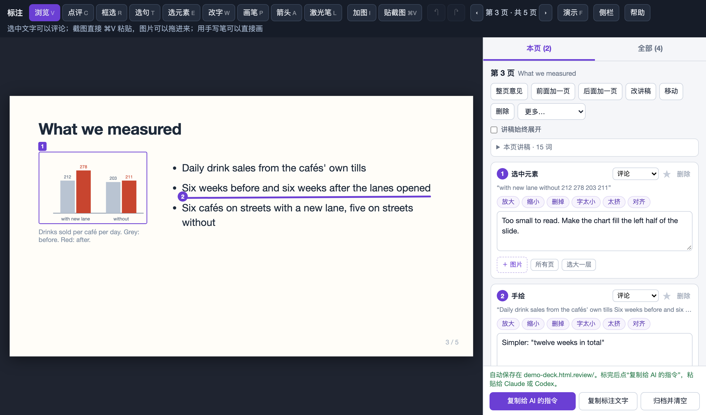
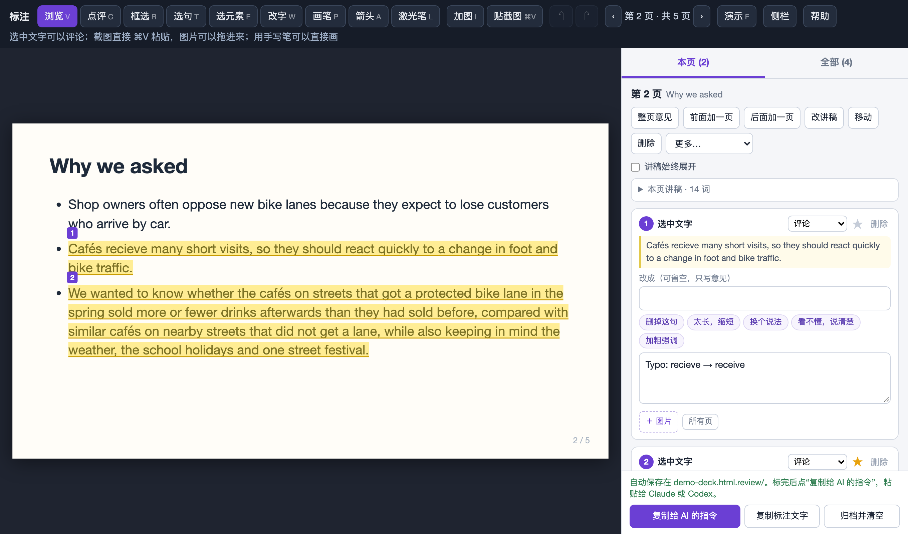
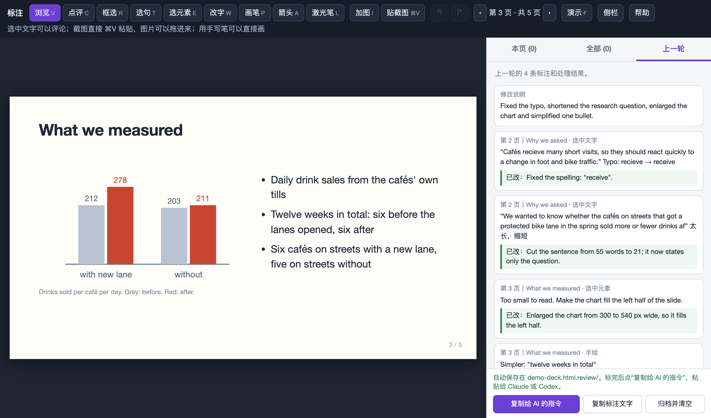

# Redpen tutorial

[中文版](tutorial.zh-CN.md)

This walks you through one complete round on the demo deck: mark it up, hand it to an agent, read the replies.
It takes about ten minutes. After that come the things you will want for your own files: generated files, LaTeX
papers, posters, and the iPad.

The review page is in Chinese for now. This tutorial gives every label you need with its meaning, and section 2
has the full list.

## 1. Open the demo deck

You need Python 3 and a coding agent that can read and edit files on your computer (Claude Code, Codex, Cursor
and similar).

```bash
git clone https://github.com/Sijie-Yang/redpen.git
```

```bash
python3 redpen/review.py redpen/examples/demo-deck.html
```

The terminal prints the address and your browser opens it. Leave the terminal running; Ctrl+C stops the server
when you are done.

The demo deck has five slides about bike lanes and coffee. Three things are wrong with it on purpose: a typo on
slide 2, a 55-word sentence on slide 2, and a chart on slide 3 that is too small to read.

## 2. The page

The document is on the left, exactly as it normally looks. Your notes are on the right. The tools are on top.



**Toolbar**

| Label | Key | Meaning |
|---|---|---|
| 浏览 | `V` | Browse. Nothing is added when you click. You can still select text to comment on it |
| 点评 | `C` | Pin: click anywhere to leave a comment at that point |
| 框选 | `R` | Box: drag a rectangle around a region |
| 选句 | `T` | Sentence: click a sentence to select all of it |
| 选元素 | `E` | Element: click a figure, a table or a paragraph to select the whole thing |
| 改字 | `W` | Edit text in place (HTML only) |
| 画笔 | `P` | Pen: draw freehand |
| 箭头 | `A` | Arrow: drag from one place to another |
| 激光笔 | `L` | Laser pointer, for presenting. Leaves no note |
| 加图 | `I` | Add an image file to this page |
| 贴截图 | `⌘V` / `Ctrl+V` | Paste a screenshot onto this page |
| 演示 | `F` | Present full screen |
| 侧栏 | | Show or hide the sidebar |
| 帮助 | | Help |

`←` and `→` turn pages. `Esc` goes back to browsing. `⌘Z` / `Ctrl+Z` undoes.

**Sidebar**

| Label | Meaning |
|---|---|
| 本页 / 全部 / 上一轮 | Notes on this page / all notes, with an outline of the deck / the previous round with the agent's replies |
| 整页意见 | A comment on the whole slide |
| 前面加一页 / 后面加一页 | Add a slide before / after this one |
| 改讲稿 | Rewrite the speaker notes |
| 移动 / 删除 | Move / delete this slide |
| 更多… | More: do not touch this slide, split in two, merge with the next, move to backup, skip in the short version, duplicate and change |
| 本页讲稿 | The current speaker notes. 讲稿始终展开 keeps them open |

**On each note**

| Label | Meaning |
|---|---|
| 评论 ▾ | The kind of note: 评论 comment, 改文字 change text, 加图 / 换图 add or replace an image, 版式 layout, 删掉 remove, 其他 other |
| ★ | Important: the agent does these first |
| 删除 | Delete the note |
| 改成 | "Change to": type the new wording here if you already know it |
| 意见 | Your comment |
| the small purple buttons | One-click comments, such as 太长，缩短 (too long, shorten), 放大 (enlarge), 删掉 (remove) |
| + 图片 | Attach a picture to this note |
| 所有页 | Apply this note to every page |

**Bottom**

| Label | Meaning |
|---|---|
| 复制给 AI 的指令 | Copy the instruction for the agent |
| 复制标注文字 | Copy the notes as plain text |
| 归档并清空 | Archive this round and start clean, without an agent |

## 3. Fix a typo

Press `→` to go to slide 2. Press `T`, then click the sentence that begins "Cafés recieve many short visits".

The sentence is highlighted and a card appears on the right. Type your comment into the large box (意见):

> Typo: recieve → receive

If you would rather give the exact new wording, type it into 改成 instead. The agent then uses it verbatim.

There is no save button. The green line at the bottom tells you how many notes have been saved.

## 4. Shorten a sentence with one click

Still on slide 2 and still in the sentence tool, click the long third bullet. On its card, click the small button
**太长，缩短** (too long, shorten). Then click the **★** on the card to mark it as important.



Press `Esc` to leave the sentence tool.

## 5. Point at a figure

Go to slide 3. Press `E` and click the chart. The whole chart gets a frame and a number. Write:

> Too small to read. Make the chart fill the left half of the slide.

`E` picks the innermost element under the pointer. If it picks too little, click **选大一层** on the card to step
up to the element around it.

## 6. Draw

Press `P` and underline the second bullet with the mouse (or with a Pencil on an iPad). Strokes made within a
short time count as one note. Write what the stroke means:

> Simpler: "twelve weeks in total"

A stroke on its own is ambiguous, so a few words help. As a rule of thumb, agents read a line through text as
"delete" and a circle as "this one".

Press `Esc`.

## 7. Three more things worth trying

**Show, don't tell.** Take a screenshot of anything (a figure from a paper, another slide you like) and press
`⌘V` / `Ctrl+V`. The picture lands on the page. Drag it to where you want it and resize it. On its card, choose
whether the agent should place it here (放在这个位置), use it to replace the image underneath (替换下面这张图), or
treat it only as an example of what you want (只是参考，不放进去).

**Change the deck.** On slide 4, click **后面加一页** (add a slide after), give the new slide a title, pick a layout
and say in a sentence what should be on it.

**Rewrite speaker notes.** Click **改讲稿** and edit the text. The agent receives the full new text.

Then open the tab **全部** to see every note in one list, next to an outline of the deck.

## 8. Hand it to your agent

Click **复制给 AI 的指令** at the bottom right and paste into your agent. It does not matter which project or
conversation the agent is in: the instruction contains the full paths of the file, the notes and the rules.

The pasted text is in Chinese. In English it says:

> Please apply the notes I left in the review tool to: /…/demo-deck.html
>
> 1. Read the list of notes first: /…/demo-deck.html.review/annotations.md
> 2. For coordinates, target elements or images, look in: /…/annotations.json
> 3. Find out whether this file is hand-written or generated from a source; edit the source
> 4. Rules and data format: /…/redpen/AGENTS.md
> 5. When done, write a status and a reply on each note, then run: `review.py archive …`

Agents that read Chinese instructions (all current ones do) need nothing else. You can also simply say "apply my
review notes on demo-deck.html following redpen/AGENTS.md".

The agent now:

1. reads `annotations.md`, and `annotations.json` where it needs exact data;
2. opens every picture you attached;
3. edits the source, important notes first, and rebuilds if there is a build step;
4. writes on every note whether it is done, partly done or skipped, with one sentence of explanation;
5. archives the round.

## 9. Read the replies

Keep the review page open while the agent works. A few seconds after it archives the round, the page empties
itself, offers to reload the changed file, and the tab **上一轮** (previous round) shows each of your notes with
the agent's reply: 已改 (done), 部分已改 (partly done) or 没有改 (not done), and why.



If something is still not right, mark it up again and hand over again. Each round is kept in
`demo-deck.html.review/archive/`.

That is the whole loop.

## 10. Your own files

### A file that is generated from something else

Most real documents are built: a PDF from LaTeX, a deck from a template, a figure from a plotting script. Tell
Redpen once what to edit and how to rebuild. It stores this in the review folder and includes it in every
instruction from then on.

```bash
python3 redpen/review.py talk.html --source slides.md --build "python3 build.py"
```

### A LaTeX paper

```bash
python3 redpen/review.py paper.pdf --source paper.tex --build "latexmk -pdf -synctex=1 paper.tex"
```

PDFs need poppler (`brew install poppler`, or `apt install poppler-utils`). You can select sentences in the PDF
just as in HTML. If the PDF was compiled with `-synctex=1` and the `synctex` command is available (it comes with
TeX Live and MacTeX), each note carries the `.tex` file and line it refers to, so the agent goes straight there,
also in a paper split over many files.

### A poster or a report (one long HTML page)

Redpen decides by itself whether an HTML file is a deck or a single page. If it guesses wrong:

```bash
python3 redpen/review.py poster.html --page
```

```bash
python3 redpen/review.py talk.html --slides "section.slide"
```

### Figures

A single image, or a folder of images, each shown as one page:

```bash
python3 redpen/review.py figures/
```

Remember that an agent cannot edit a PNG. Tell it where the plotting script is with `--source`.

### PowerPoint and Keynote

Export to PDF and review the PDF. The page number is the slide number.

## 11. iPad

**Live.** Start with `--lan` and open the printed link in Safari on the iPad. Both devices must be on the same
network (the same Wi-Fi, or Tailscale).

```bash
python3 redpen/review.py paper.pdf --lan
```

With an Apple Pencil you do not pick a tool: the Pencil draws, your finger scrolls. Everything is saved on the
computer, so you can sit down at it afterwards, type comments next to your strokes and hand over.

**Offline.** Annotate the PDF by hand in any app, on a plane if you like. Send the annotated copy back to the
computer under a different name, so that you still have the untouched original. Then tell your agent:

> I annotated paper.pdf on my iPad. The annotated copy is paper-marked.pdf. Apply my notes.

It runs `review.py import paper.pdf paper-marked.pdf` (this needs `pip install pillow numpy`), which finds
everything you wrote by comparing the two files, and then reads your handwriting from the crops.

Two things to keep in mind: write on the page itself, not in pop-up sticky notes (their text is not on the page,
so it cannot be found), and for an HTML deck annotate its PDF export.

## 12. When something goes wrong

| Problem | What to do |
|---|---|
| The deck shows as one long page, or the page count is wrong | Give the selector of one slide: `--slides "<css>"` |
| Speaker notes or slide titles are not found | `--notes "<css>"`, `--title "<css>"` |
| Images or styles are missing in the HTML | The HTML loads files from a parent folder. Serve that folder: `--root ..` |
| "pdftoppm" is missing | Install poppler |
| No `.tex` line numbers | Compile with `-synctex=1` and keep the `.synctex.gz` file next to the PDF |
| The port is taken | Redpen tries the next 30 ports by itself, or choose one with `--port` |
| Notes seem to be gone | Nothing is ever deleted. Look in `<file>.review/history/` and `archive/` |
| You want to start over without an agent | **归档并清空** at the bottom right |
| The iPad cannot open the link | Check that both devices are on the same network and that you used the full link with `?k=…` |

## 13. Good habits

- Write notes the way you would for a colleague: say what is wrong or what you want, not only "fix".
- Use ★ sparingly, for the notes that must not be missed.
- One round, one batch. It is quicker to mark up twenty things and hand over once than to go back and forth.
- Read the replies. An honest agent says "skipped, because…" when a note was unclear, and that is your next round.
