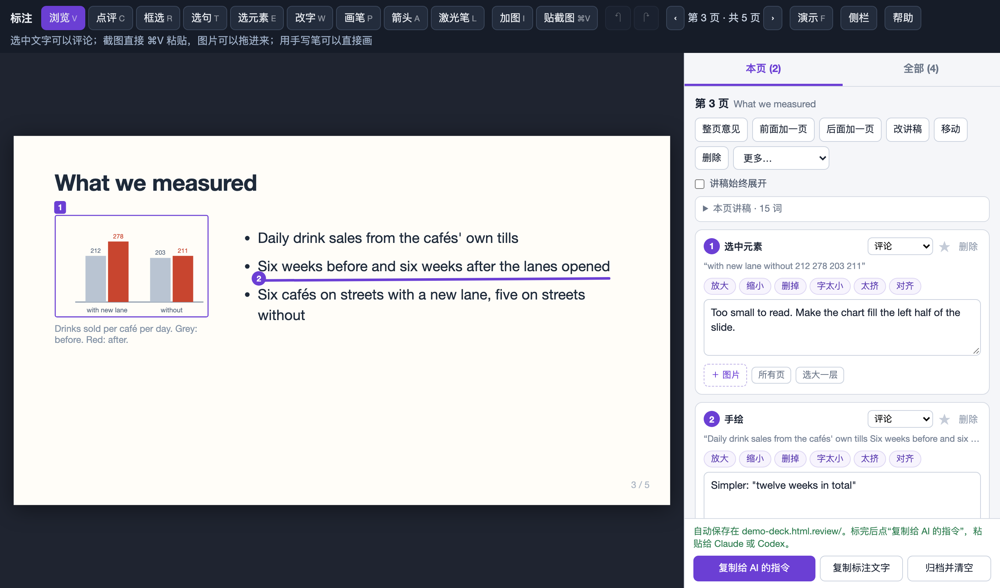
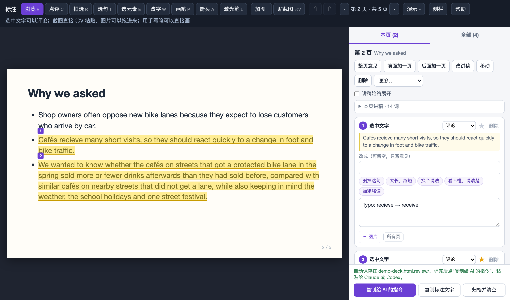
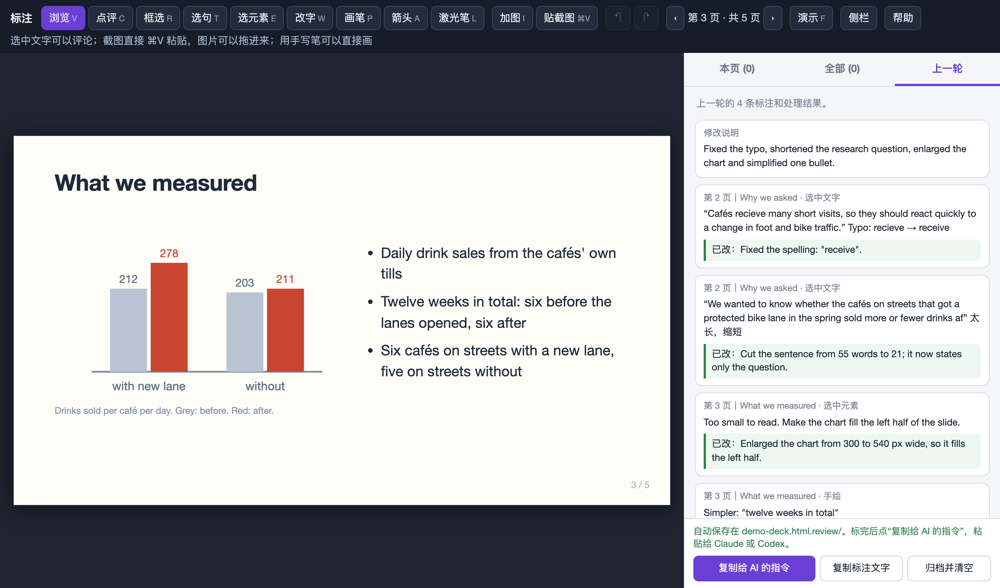

# Redpen 教程

[English](tutorial.md)

这份教程用示例幻灯片带你走完整的一轮：批注、交给 AI、看回复，大约十分钟。后半部分讲用在自己的文件上会遇到的情况：
由别的文件生成的文件、LaTeX 论文、海报、iPad。

## 1. 打开示例

需要 Python 3，以及一个能在你电脑上读写文件的 AI 编程助手（Claude Code、Codex、Cursor 等）。

```bash
git clone https://github.com/Sijie-Yang/redpen.git
```

```bash
python3 redpen/review.py redpen/examples/demo-deck.html
```

终端会打印地址，浏览器自动打开。终端不要关；用完按 Ctrl+C 停掉服务。

示例是一份五页的幻灯片，讲自行车道和咖啡店。里面故意留了三个毛病：第 2 页有一个错别字（recieve）、
有一句 55 个词的长句，第 3 页的图小得看不清。

## 2. 认识页面

左边是文件本身，和平时看到的一样。右边是你的批注。上面是工具。



**工具栏**

| 工具 | 快捷键 | 作用 |
|---|---|---|
| 浏览 | `V` | 点击不会留下标注。仍然可以选中文字来评论 |
| 点评 | `C` | 点任意位置，在那里留一条意见 |
| 框选 | `R` | 拖一个矩形，圈出一块区域 |
| 选句 | `T` | 点一句话，选中整句 |
| 选元素 | `E` | 点一张图、一个表格或一段文字，选中整个元素 |
| 改字 | `W` | 就地改文字（只对 HTML） |
| 画笔 | `P` | 随手画 |
| 箭头 | `A` | 从一处拖到另一处 |
| 激光笔 | `L` | 演示时指给别人看，不留标注 |
| 加图 | `I` | 把一个图片文件加到这一页 |
| 贴截图 | `⌘V` / `Ctrl+V` | 把截图贴到这一页 |
| 演示 | `F` | 全屏演示 |
| 侧栏、帮助 | | 收起或展开右边栏；查看帮助 |

`←` `→` 翻页，`Esc` 回到浏览，`⌘Z` / `Ctrl+Z` 撤销。

**右边栏**

- **本页 / 全部 / 上一轮**：这一页的标注；全部标注和整份幻灯片的目录；上一轮的标注和 AI 的回复。
- **整页意见**：对整页提意见。**前面加一页 / 后面加一页 / 移动 / 删除**：改幻灯片的结构。**改讲稿**：重写这一页的讲稿。
- **更多…**：这页不要动、拆成两页、和下一页合并、移到备用页、短版本里跳过、复制这一页再改。
- 每条标注的卡片上：类别（评论、改文字、加图 / 换图、版式、删掉、其他）、★（重要，AI 先处理）、“改成”（已经想好新的写法就填这里）、
  意见、紫色的小按钮（一键填入常用意见）、“+ 图片”（给这条配图）、“所有页”（每一页都照这条改）。
- 底部：**复制给 AI 的指令**、**复制标注文字**、**归档并清空**（不经过 AI，直接结束这一轮）。

## 3. 改一个错别字

按 `→` 到第 2 页。按 `T`，点 “Cafés recieve many short visits” 开头的那句话。

这句话被高亮，右边出现一张卡片。在“意见”里写：

> 错别字：recieve → receive

如果你已经想好了新的写法，直接填在“改成”里，AI 会原样采用。

没有保存按钮。底部那行绿字会告诉你已经保存了几条。

## 4. 一键让它缩短

还在第 2 页、还在选句工具里，点第三个要点（那句长句）。在它的卡片上点紫色小按钮 **“太长，缩短”**，再点卡片上的 **★** 标为重要。



按 `Esc` 退出选句。

## 5. 指着一张图说

到第 3 页。按 `E`，点那张柱状图。整张图被框住并编号。写：

> 太小看不清。放大到占满左半边。

`E` 选中的是鼠标下最里面的那个元素。如果选小了，点卡片上的 **“选大一层”**，换成外面一层。

## 6. 画

按 `P`，用鼠标（在 iPad 上用笔）在第二个要点下面画一条线。短时间内连续的几笔算一条标注。写上这一笔是什么意思：

> 说简单点：一共十二周

光有笔迹容易有歧义，配几个字更稳妥。一般来说，AI 会把划过文字的线理解成“删掉”，把圈理解成“这个”。

按 `Esc`。

## 7. 再试三样

**用图说话。** 随便截一张图（论文里的图、你喜欢的别人的一页），按 `⌘V` / `Ctrl+V`，图会落在页面上。拖到想要的位置，调整大小。
在它的卡片上选用法：“放在这个位置”、“替换下面这张图”，或者“只是参考，不放进去”。

**改结构。** 在第 4 页点 **“后面加一页”**，给新页起个标题，选一个版式，用一句话说明这页放什么。

**改讲稿。** 点 **“改讲稿”**，直接编辑。AI 拿到的是完整的新讲稿。

然后打开 **“全部”** 标签，所有标注和整份幻灯片的目录都在这里。

## 8. 交给 AI

点右下角 **“复制给 AI 的指令”**，粘贴给你的 AI。AI 在哪个项目、哪个对话里都没关系：指令里带着文件、标注和规则的完整路径。

粘贴出来的内容是这样的：

> 请按我在审阅工具里留的标注修改：/…/demo-deck.html
>
> 1. 先读标注清单：/…/demo-deck.html.review/annotations.md
> 2. 需要坐标、目标元素或图片时查：/…/annotations.json
> 3. 先确认这个文件是手写的还是由别的源文件生成的，改源文件
> 4. 规则和数据格式见：/…/redpen/AGENTS.md
> 5. 改完后在 annotations.json 里给每条写上 status 和 reply，然后运行：`review.py archive …`

接下来 AI 会：

1. 读 `annotations.md`，需要精确数据时查 `annotations.json`；
2. 打开你附的每一张图；
3. 改源文件（重要的先改），有生成步骤就重新生成；
4. 给每条标注写上“已改 / 部分已改 / 没有改”和一句说明；
5. 把这一轮归档。

## 9. 看回复

AI 干活的时候，审阅页面开着就行。它归档后几秒内，页面会自动清空、提示刷新到改过的文件，**“上一轮”** 标签里会列出你的每条标注和 AI 的回复。



还有不满意的地方，就再标、再交。每一轮都保存在 `demo-deck.html.review/archive/` 里。

整个流程就是这样。

## 10. 用在自己的文件上

### 由别的文件生成的文件

真实的文档大多是生成的：LaTeX 编出来的 PDF、模板生成的幻灯片、脚本画出来的图。告诉 Redpen 一次该改哪个文件、怎么重新生成，
它会记在审阅文件夹里，以后每次的指令都会带上。

```bash
python3 redpen/review.py talk.html --source slides.md --build "python3 build.py"
```

### LaTeX 论文

```bash
python3 redpen/review.py paper.pdf --source paper.tex --build "latexmk -pdf -synctex=1 paper.tex"
```

打开 PDF 需要 poppler（`brew install poppler` 或 `apt install poppler-utils`）。PDF 里同样可以选句。
如果编译时加了 `-synctex=1`，并且系统里有 `synctex` 命令（TeX Live 和 MacTeX 自带），每条标注都会带上对应的 `.tex` 文件和行号，
AI 直接跳过去改，论文拆成很多个文件也没问题。

### 海报、报告（一个长的 HTML 页面）

Redpen 会自己判断一个 HTML 是幻灯片还是单页。判断错了可以指定：

```bash
python3 redpen/review.py poster.html --page
```

```bash
python3 redpen/review.py talk.html --slides "section.slide"
```

### 图

一张图，或者一个装图片的文件夹（每张图算一页）：

```bash
python3 redpen/review.py figures/
```

注意 AI 改不了 PNG 本身，用 `--source` 告诉它画图脚本在哪。

### PPT 和 Keynote

导出成 PDF 再审阅，页码就是幻灯片序号。

## 11. iPad

**在线。** 启动时加 `--lan`，在 iPad 的 Safari 里打开终端打印的链接。两台设备要在同一个网络里（同一个 Wi-Fi，或 Tailscale）。

```bash
python3 redpen/review.py paper.pdf --lan
```

用 Apple Pencil 不用选工具：笔用来画，手指用来滚动。标注都存在电脑上，之后可以回到电脑前，在笔迹旁边补几个字，再交给 AI。

**离线。** 用任何 App 在 PDF 上手写批注，飞机上也行。把批注件换个名字传回电脑，原件留着别覆盖。然后对 AI 说：

> 我在 iPad 上批注了 paper.pdf，批注件是 paper-marked.pdf，按批注改。

它会运行 `review.py import paper.pdf paper-marked.pdf`（需要 `pip install pillow numpy`），对比两份文件找出你写的每一处，
再看截图读你的字。

两点注意：字要写在页面上，不要写在弹出式便签里（便签内容不在页面上，对比不出来）；HTML 幻灯片请批注它导出的 PDF。

## 12. 出问题的时候

| 问题 | 处理 |
|---|---|
| 幻灯片被当成一个长页面，或页数不对 | 给出单页幻灯片的选择器：`--slides "<css>"` |
| 找不到讲稿或标题 | `--notes "<css>"`、`--title "<css>"` |
| HTML 里的图片或样式没出来 | HTML 引用了上级文件夹的文件，把那个文件夹作为根目录：`--root ..` |
| 提示缺少 pdftoppm | 安装 poppler |
| 没有 `.tex` 行号 | 编译时加 `-synctex=1`，并把 `.synctex.gz` 留在 PDF 旁边 |
| 端口被占用 | Redpen 会自动往后试 30 个端口，也可以用 `--port` 指定 |
| 标注好像不见了 | 标注不会被删除。去 `<文件>.review/history/` 和 `archive/` 里找 |
| 想不经过 AI 重新开始 | 右下角 **“归档并清空”** |
| iPad 打不开链接 | 确认两台设备在同一个网络，并且用的是带 `?k=…` 的完整链接 |

## 13. 几个好习惯

- 像给同事提意见那样写：说清楚哪里不对、想要什么，不要只写“改一下”。
- ★ 省着用，留给不能漏掉的那几条。
- 攒一批再交。一次标二十处再交给 AI，比来回二十次快得多。
- 看回复。靠谱的 AI 遇到没看懂的标注会写“没有改，因为……”，那就是你下一轮要说清楚的地方。
